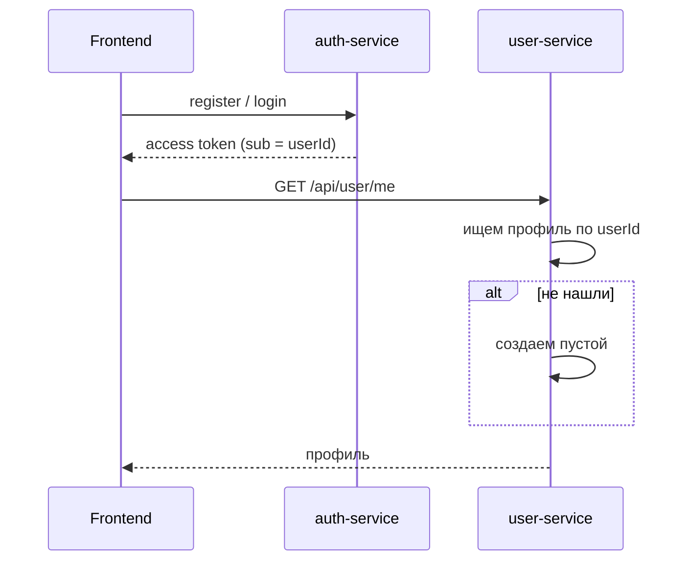

# user-service

Профили пользователей: ФИО, адреса, позже данные продавца. Логин, пароль и токены хранятся в auth-service, здесь их нет.

Kotlin + Spring Boot, Gradle. Порт 8083, база user_db.
Через gateway сервис доступен по /api/user/**.

## Создание профиля

Отдельного шага "создать профиль" нет. Профиль создается при первом запросе пользователя в user-service.

auth-service про user-service ничего не знает и никуда не отправляет событие о регистрации (Kafka тут не используем).

Как работает:

1. Пользователь регистрируется и логинится в auth-service, получает access token.
2. Фронт с этим токеном делает запрос в user-service, например GET /api/user/me.
3. user-service берет id пользователя из токена (поле sub).
4. Ищет профиль по user_id. Если нашел, возвращает. Если нет, создает пустой и возвращает его.

Если придут два запроса одновременно, оба могут не найти профиль и оба попробуют его создать. На user_id стоит unique, поэтому второй insert упадет с DataIntegrityViolationException. Мы ее ловим и просто ищем профиль еще раз, к этому моменту он уже есть.

user_id в таблицах user-service это обычный uuid без внешнего ключа, потому что таблица users лежит в другой базе (auth_db).

## Что не учтено

Если пользователя заблокируют или удалят в auth-service, user-service об этом не узнает. Для MVP оставляем так, если понадобится, добавим события.

## Локальный запуск

Нужна база user_db в Postgres. Логин/пароль от базы и jwt.secret (тот же, что у auth-service) кладутся в src/main/resources/application-local.yaml, в git он не попадает. Запуск с профилем local: -Dspring.profiles.active=local
