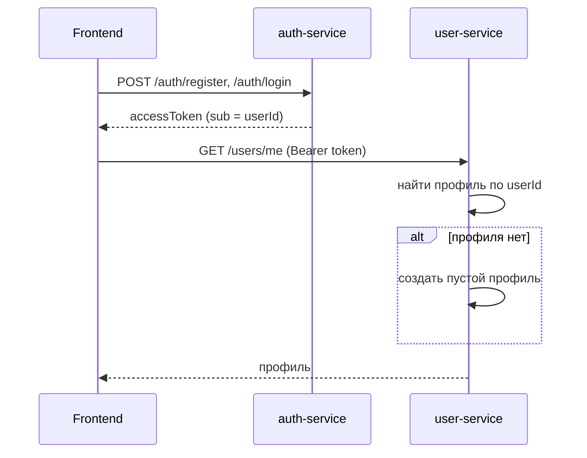

# user-service

Сервис профилей пользователей маркетплейса. Аккаунты, пароли и токены живут в **auth-service**, здесь — данные о человеке (ФИО, адреса, данные продавца).

## Как создаётся профиль (get-or-create)

auth-service и user-service **напрямую не общаются**: ни HTTP-вызовов между ними, ни событий в Kafka.

Профиль создаётся **лениво** — при первом обращении пользователя к user-service:

1. Пользователь регистрируется в auth-service и получает JWT.
2. Фронт вызывает любой эндпоинт user-service, например `GET /users/me`.
3. user-service берёт id пользователя из токена (claim `sub`, UUID) или из заголовка `X-User-Id`, который проставляет API Gateway.
4. Ищет профиль по `user_id`:
   - нашёл — возвращает его;
   - не нашёл — создаёт пустой профиль с этим `user_id` и возвращает его.

### Одновременные запросы

Если два запроса придут одновременно, оба могут не найти профиль и попытаться его создать. Защита:

- в таблице профилей `user_id` уникален (`unique`);
- при попытке создать дубль база вернёт ошибку уникальности, сервис ловит `DataIntegrityViolationException` и просто перечитывает уже созданный профиль.

### Почему так

- сервисы не зависят друг от друга: если user-service недоступен во время регистрации, ничего не ломается — профиль создастся позже;
- не нужна Kafka и межсервисные вызовы;
- `user_id` в user-service — просто UUID без внешнего ключа: таблица `users` живёт в другой базе (auth-service).

### Ограничения

- если пользователя заблокируют или удалят в auth-service, user-service об этом не узнает. Для MVP это допустимо; если понадобится синхронизация — добавим события (Kafka).